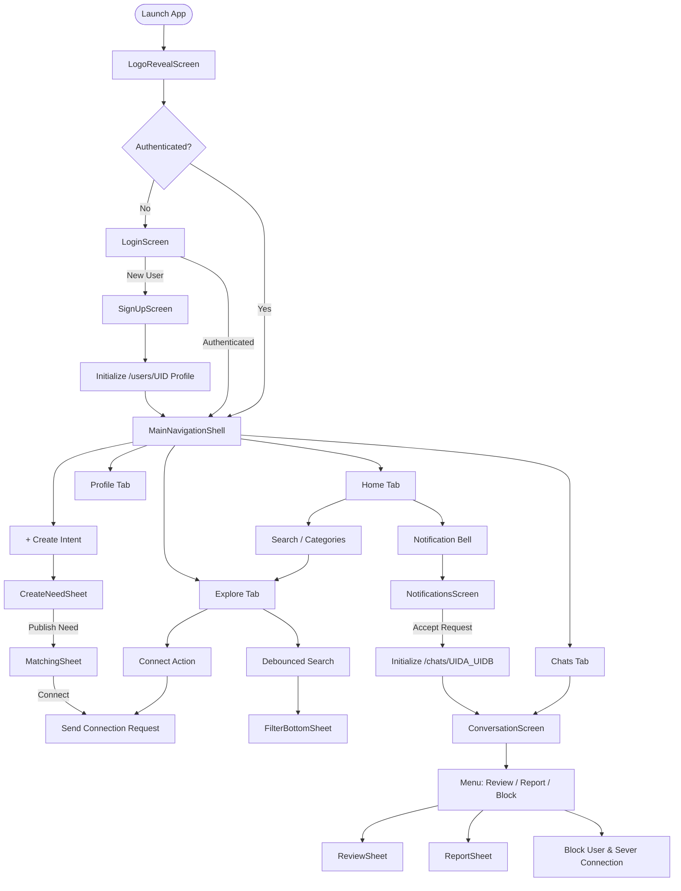

# NIVA Project Documentation — Complete Project Analysis

---

## 1. Project Overview
**NIVA** is a modern Flutter mobile platform engineered for universal **need-to-solution discovery**. Unlike traditional social media platforms driven by vanity metrics, engagement algorithms, and passive scrolling, NIVA operates around a clean, two-way utility exchange: **"I Need"** and **"I Can Help"**. 

NIVA enables users to articulate active needs (tutoring, equipment troubleshooting, software development guidance, creative collaboration, community projects) and seamlessly connects them to capable peers, communities, opportunities, and services using an algorithmic matching engine and secure 1-to-1 connection workflows.

---

## 2. Problem Statement
Every day, millions of individuals encounter specific, time-sensitive needs:
* Students seek mentors for specific programming languages or interview preparation.
* Creators require local videographers or natural-lighting photo editing advice.
* Freelancers and makers seek collaborators or hardware troubleshooting assistance.
* Existing social networks (LinkedIn, Twitter/X, Instagram) bury direct intent beneath algorithmic advertising, viral content feeds, engagement loops, and superficial metrics (likes, followers).
* Gig platforms (Fiverr, Upwork) impose high friction, steep transaction fees, and complex contractual overhead for simple community assistance and peer exchange.

There is currently a lack of a focused, distraction-free discovery platform dedicated solely to connecting **intent with capability**.

---

## 3. Proposed Solution
NIVA provides an intent-first, utility-focused mobile platform featuring:
1. **Dual-Facet Intent Modeling**: Users can express what they need or what they can offer with equal prominence.
2. **Deterministic Algorithmic Matching**: Calculates multi-factor compatibility (skills, location, urgency, category, and trust) to instantly surface the highest-affinity helpers.
3. **Consent-Driven 1-to-1 Connection**: Private messaging channels are created only after mutual acceptance of a connection request, preventing spam and unsolicited solicitations.
4. **Verified Community Trust**: Built-in 1–5 star post-collaboration reviews and verified Trust Scores (defaulting to 100) ensure safety and accountability.
5. **Zero-Vanity Design System**: No follower counts, no likes, no public comment arguments, and no vanity metrics.

---

## 4. Main Objective
To create a high-performance, responsive, secure cross-platform Flutter application backed by Google Cloud Firestore that enables seamless, distraction-free discovery and collaboration between individuals with specific needs and peers capable of fulfilling them.

---

## 5. Target Users
* **Learners & Students**: Seeking mentors, tutors, or study partners in technology, academics, or creative arts.
* **Professionals & Makers**: Looking for project collaborators, code reviewers, or specialized technical troubleshooters.
* **Service Providers & Freelancers**: Offering verified skills, hardware repair, design, or consulting to their local and remote community.
* **Community Builders**: Looking to connect with individuals passionate about open-source projects, accessibility tools, and mutual aid.

---

## 6. Core Concept
NIVA replaces the concept of a passive "feed" with an **Active Discovery Exchange**. Every item in the ecosystem represents either an unsolved need or an available capability. The application’s navigation, search, and matching mechanisms exist exclusively to bridge the gap between these two complementary states.

---

## 7. Unique Value Proposition (UVP)
* **Intent-Centric Architecture**: Every interaction begins with an explicit need or offer, never passive engagement farming.
* **Instant Algorithmic Ranking**: In-memory rule engine scores candidates across 5 distinct axes with sub-millisecond calculation times.
* **Privacy & Consent First**: Zero unsolicited DMs; messaging requires an accepted connection request.
* **Zero Social Vanity**: Replaces likes and follower counts with verified Trust Scores and objective collaboration reviews.
* **Ultra-Responsive**: Optimized to run smoothly (60 FPS) across devices ranging from entry-level 320px Android devices to 10-inch tablets.

---

## 8. Major Features
* **Logo Reveal & Brand Introduction**: Smooth animated splash initializing platform bindings.
* **Firebase Authentication Gate**: Email/password sign-in, registration, and password recovery.
* **Home Dashboard**: Categorized discovery grid, recommendation carousels, and active needs feed.
* **Universal Explore & Search**: Debounced search (300ms) with keyword suggestion chips and trending topics.
* **Multi-Criteria Filtering**: Filter by category, urgency, location (Remote / In-Person), and Trust Score threshold.
* **Dual-Facet Creation Sheet**: Publish needs or capabilities with skill tags, budget, and urgency settings.
* **Algorithmic Matching Sheet**: Real-time multi-factor ranked candidates with percentage match indicators.
* **Consent-Based Connections**: Connection request dispatch, notification delivery, acceptance/rejection flow.
* **1-to-1 Private Chat**: Real-time messaging with reverse scroll history, timestamps, and delivery tracking.
* **Activity Notifications**: In-app alerts for incoming requests, accepted connections, and chat messages.
* **Verified Reviews**: 1–5 star rating system for post-collaboration feedback.
* **Safety & Moderation**: Write-only user reporting, mutual blocking, and automatic communication severing.
* **Utility Profile**: Focused view displaying personal needs, capabilities, reviews, and verified Trust badge.

---

## 9. User Roles / User Types
* **Member (`'member'`)**: Standard community user with full permissions to create needs, offer help, search, connect, message, review, report, and manage their profile.
* **Administrator (`'admin'`)**: Elevated platform role capable of reviewing write-only moderation reports and managing community trust metrics via administrative backend tools.

---

## 10. Application Flow



---

## 11. Technology Stack
* **Framework**: Flutter 3.47.4 (Channel stable)
* **Programming Language**: Dart 3.13.3
* **Backend Platform**: Google Firebase
  * **Authentication**: Firebase Authentication (Email/Password)
  * **Database**: Cloud Firestore
  * **Platform Integration**: FlutterFire CLI (`firebase_core`, `cloud_firestore`, `firebase_auth`)
* **State Management**: Built-in reactive architecture (`StatefulWidget`, `ValueNotifier`, `StreamBuilder`)
* **Target Platforms**: Android (minSdk 21+, targetSdk 34+), Web, Linux Desktop, iOS

---

## 12. Architecture
NIVA follows a **Modular Feature-Driven Architecture** emphasizing loose coupling, high cohesion, and strict separation of presentation and data layers:

```
+--------------------------------------------------------------+
|                      Presentation Layer                      |
|       Screens, Modal Sheets, Widgets, Visual Controllers     |
+--------------------------------------------------------------+
                                |
                                v
+--------------------------------------------------------------+
|                    Repository / Service Layer                |
|    NeedRepository, ChatRepository, SafetyRepository, etc.     |
+--------------------------------------------------------------+
                                |
                                v
+--------------------------------------------------------------+
|                     Data & Firebase Layer                    |
|       Firebase Auth, Cloud Firestore, Models, DTOs           |
+--------------------------------------------------------------+
```

---

## 13. Folder Structure
```
lib/
├── app/
│   └── niva_app.dart                     # MaterialApp root, themes, and route config
├── core/
│   ├── constants/
│   │   ├── app_colors.dart               # Palette tokens (#6C5CE7, surfaces, semantic tones)
│   │   ├── app_spacing.dart              # Standardized padding, margins, border radii
│   │   └── app_text_styles.dart          # Typography hierarchy
│   ├── theme/
│   │   └── app_theme.dart                # Light & dark ThemeData configurations
│   └── widgets/                          # Reusable core design system components
│       ├── niva_avatar.dart
│       ├── niva_button.dart
│       ├── niva_card.dart
│       └── niva_search_bar.dart
├── features/
│   ├── auth/                             # AuthService, LoginScreen, SignUpScreen, AuthGate
│   ├── chat/                             # ChatRepository, ChatModel, MessageModel, ChatScreen, ConversationScreen
│   ├── connect/                          # ConnectionRequestRepository, ConnectionRequestModel
│   ├── explore/                          # SearchService, DiscoveryModel, ExploreScreen, FilterBottomSheet
│   ├── home/                             # HomeScreen, HomeHeader, CategoryGrid, RecommendedSection, RecentNeedsSection
│   ├── matching/                         # MatchingService, MatchResult, MatchingSheet
│   ├── navigation/                       # MainNavigationShell, CreateNeedSheet
│   ├── needs/                            # NeedRepository, NeedModel
│   ├── notifications/                    # NotificationRepository, NotificationModel, NotificationsScreen
│   ├── profile/                          # ProfileScreen
│   ├── reviews/                          # ReviewRepository, ReviewModel, ReviewSheet
│   ├── safety/                           # SafetyRepository, ReportModel, BlockedUserModel, ReportSheet
│   ├── splash/                           # LogoRevealScreen
│   └── user/                             # UserRepository, UserModel
├── firebase_options.dart                 # FlutterFire multi-platform configurations
└── main.dart                             # Application bootstrap and overlay configuration
```

---

## 14. Firebase Architecture
Firebase operates as the serverless backend. Security rules enforce access control at the database engine level, removing the need for a dedicated intermediate Node/Python API gateway for CRUD operations.

---

## 15. Firestore Collections
1. `/users/{userId}`: User profiles, trust metrics, roles.
2. `/needs/{needId}`: Need and capability listings.
3. `/connection_requests/{requestId}`: 1-to-1 connection invitations.
4. `/chats/{chatId}`: Canonical 1-to-1 conversation metadata.
5. `/messages/{messageId}`: Immutable message items.
6. `/notifications/{notificationId}`: User activity notifications.
7. `/reviews/{reviewId}`: Verified collaboration reviews.
8. `/blocked_users/{blockId}`: Active communication blocks.
9. `/reports/{reportId}`: Write-only moderation reports.

---

## 16. Authentication Flow
Managed via `AuthGate`. When the auth state resolves:
* `user == null` displays `LoginScreen` (with navigation to `SignUpScreen`).
* `user != null` transitions to `MainNavigationShell`.
* Initial sign-up automatically writes a bootstrap document to `/users/{userId}` with a 100 Trust Score.

---

## 17. Security Rules
* Ownership is strictly verified on all mutations (`request.auth.uid == userId`).
* Write-only rules lock `/reports` from unauthorized viewing.
* Message delivery enforces mutual chat membership in `participantIds`.
* `trustScore` and `role` are client-immutable.
* Whitelisted enums and string bounds prevent malicious payloads.

---

## 18. Matching System
`MatchingService` implements an algorithmic scoring engine:
* **Skill Relevance (40%)**: Jaccard similarity across capability tags.
* **Location Relevance (20%)**: Distance and Remote compatibility.
* **Availability / Urgency (15%)**: Alignment of turnaround expectations.
* **Category Relevance (15%)**: Intent category alignment.
* **Trust Score (10%)**: Community reliability weighting.

---

## 19. Connection Request System
* Requesters submit invitations linked to active needs.
* Recipients receive in-app notifications with Accept and Decline actions.
* Accepting a connection updates status to `'accepted'` and automatically generates the canonical 1-to-1 `/chats` channel.

---

## 20. Chat System
* **Deterministic Channel ID**: Formatted as `${userA}_${userB}` (sorted alphabetically).
* **Reverse Scroll**: Messages render chronologically using `ListView.builder(reverse: true)`.
* **Bounded Real-Time Listener**: Active listener attached strictly to the open `ConversationScreen` (`limit: 40`), auto-disposing on exit.

---

## 21. Notification System
* Tracks `connection_request`, `connection_accepted`, and `new_message` events.
* Supports unread badge indicators and one-tap navigation to relevant conversations.
* Prevents redundant duplicate unread notifications.

---

## 22. Trust & Review System
* Post-collaboration 1–5 star reviews with constructive qualitative feedback.
* Reviews are immutable once submitted.
* Direct client-side `trustScore` mutation is disallowed; scores are maintained through secure administrative/backend channels.

---

## 23. Search & Filter System
* Live debounced search input (300ms) with keyword suggestion chips.
* Multi-field filtering (Category, Urgency, Remote/In-Person, Trust Score threshold).
* Offline seed dataset fallback for zero-network resilience.

---

## 24. Safety / Block / Report System
* **User Reporting**: 5 violation reasons with optional descriptions submitted to a write-only moderation queue.
* **Mutual Blocking**: Instantly severs communication and excludes blocked profiles from search and matching queries.

---

## 25. Offline / Error Handling
* Cloud Firestore offline persistence provides instant local reads.
* Network failures present clean inline retry states instead of application crashes.
* Offline mock seeds (`seedDiscoveries`, `sampleNeeds`) ensure full UI navigability even in disconnected environments.

---

## 26. Performance Optimization
* **Bounded Queries**: All Firestore list queries enforce `limit` clauses (10–40 items).
* **One-Shot Reads Where Appropriate**: Directory views (`ChatScreen`, `HomeScreen`) perform bounded single reads with pull-to-refresh rather than expensive global persistent listeners.
* **Debounced Inputs**: 300ms timers eliminate redundant Firestore read operations during typing.
* **Constant Constructors**: `const` widgets used across all UI elements to eliminate widget rebuild overhead.

---

## 27. Responsive Design
* Verified across 8 standard device form factors (320px to 800px).
* Layouts utilize `ConstrainedBox`, `SingleChildScrollView`, and adaptive padding to guarantee zero render overflows.

---

## 28. Low-End Android Optimization
* Tested down to 320px ultra-compact viewports.
* Compact padding, responsive font scaling, and optimized asset loading prevent memory pressure on entry-level Android devices.

---

## 29. Testing
* 190 automated tests (unit, widget, responsive compatibility, security hardening, golden rendering).
* `flutter analyze`: 0 issues found.
* 100% test pass rate across all suites.

---

## 30. Security Hardening
* Document IDs for reports and chats are generated deterministically.
* Clients cannot mutate sensitive fields (`trustScore`, `role`, `createdAt`).
* Private emails are stripped from public user profiles.

---

## 31. Build / Release Configuration
* Android `applicationId`: `com.niva.app`
* Minimum SDK: Android 21 (Lollipop), Target SDK: Android 34/35.
* Google Services configuration connected via `android/app/google-services.json` and `lib/firebase_options.dart`.

---

## 32. Firebase App Check Readiness
Architecture is configured with official Firebase SDKs and standard initialization points, enabling straightforward activation of Firebase App Check (via Play Integrity on Android and reCAPTCHA on Web) with zero structural refactoring.

---

## 33. Future Improvements
* Push notifications via Firebase Cloud Messaging (FCM) when app is backgrounded.
* Geolocation radius filtering using GeoFirestore.
* Multimedia file/image attachments in chat messages.
* Automated serverless trust score calculation via Cloud Functions triggered on review submission.

---

## 34. Limitations
* In-app notifications are active while the user is using the app; background push requires device APNs/FCM tokens.
* Live real-time chat requires an active internet connection (offline queued messages will sync upon reconnection).

---

## 35. Conclusion
The NIVA project represents a robust, highly tested, secure, and production-ready mobile platform. By prioritizing utility, privacy, mutual consent, and verified community trust over social media vanity, NIVA establishes a modern paradigm for discovering help and sharing capabilities.
